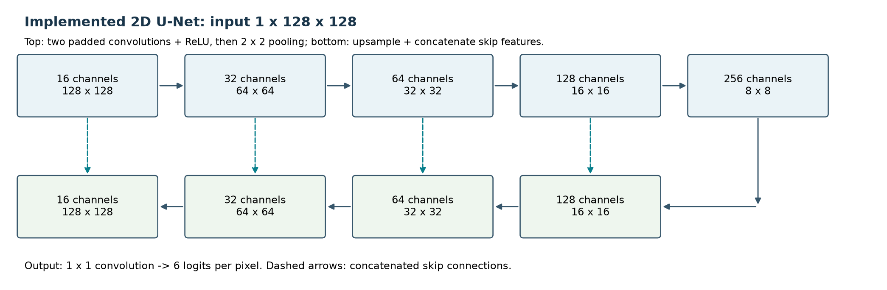
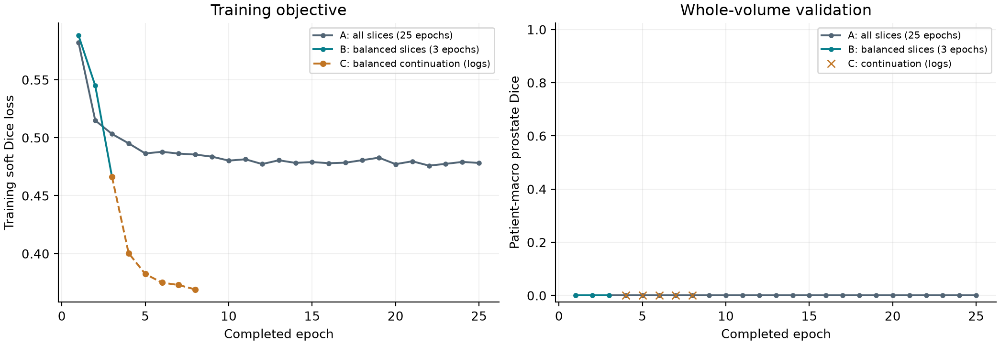
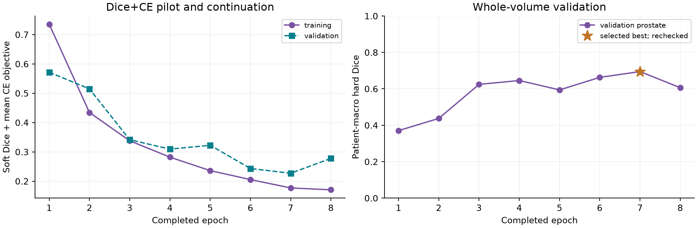
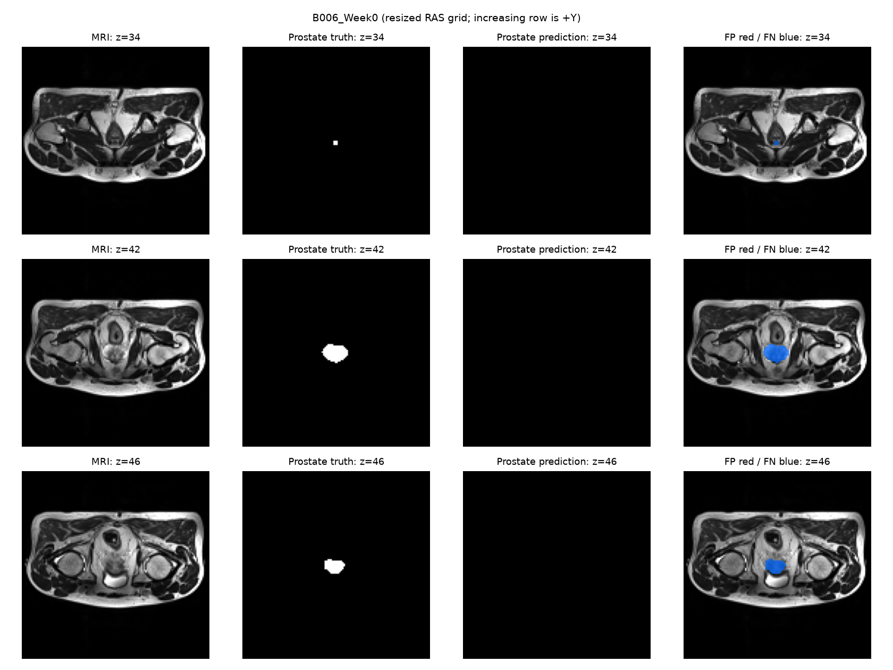
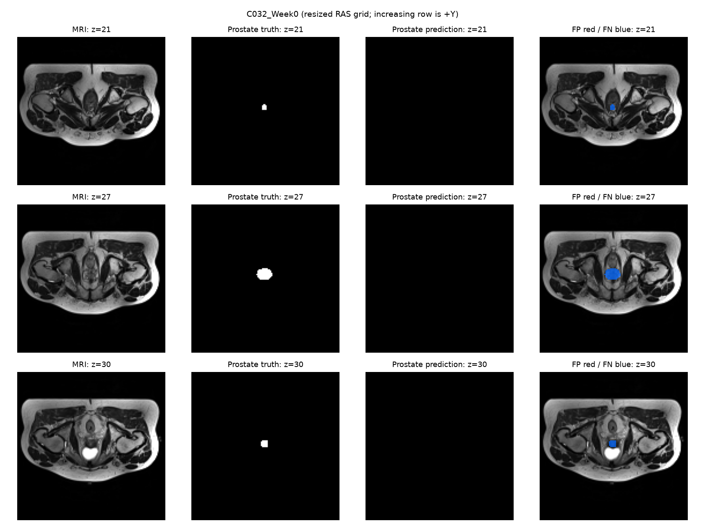
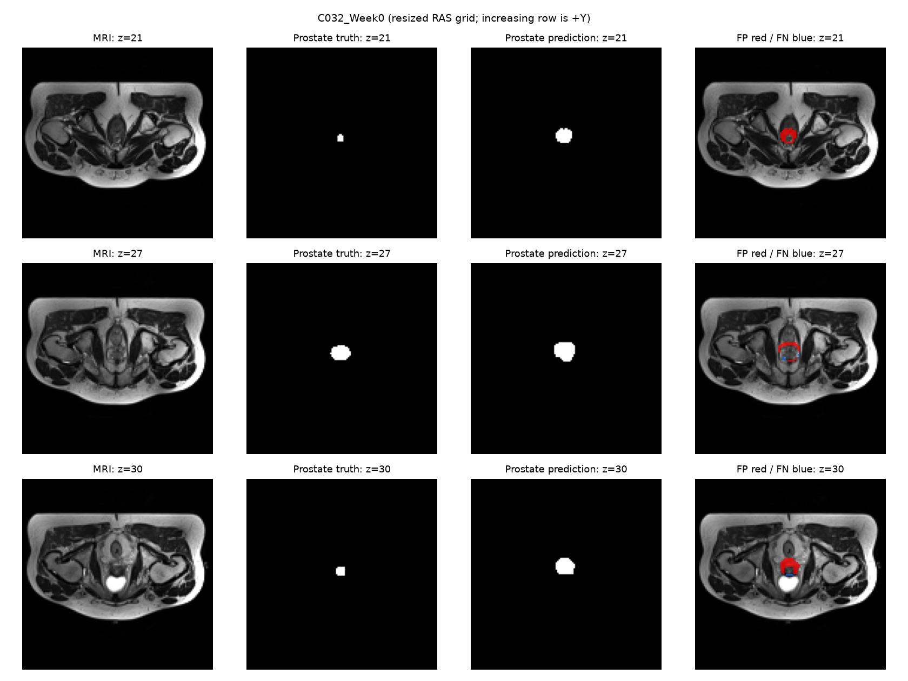
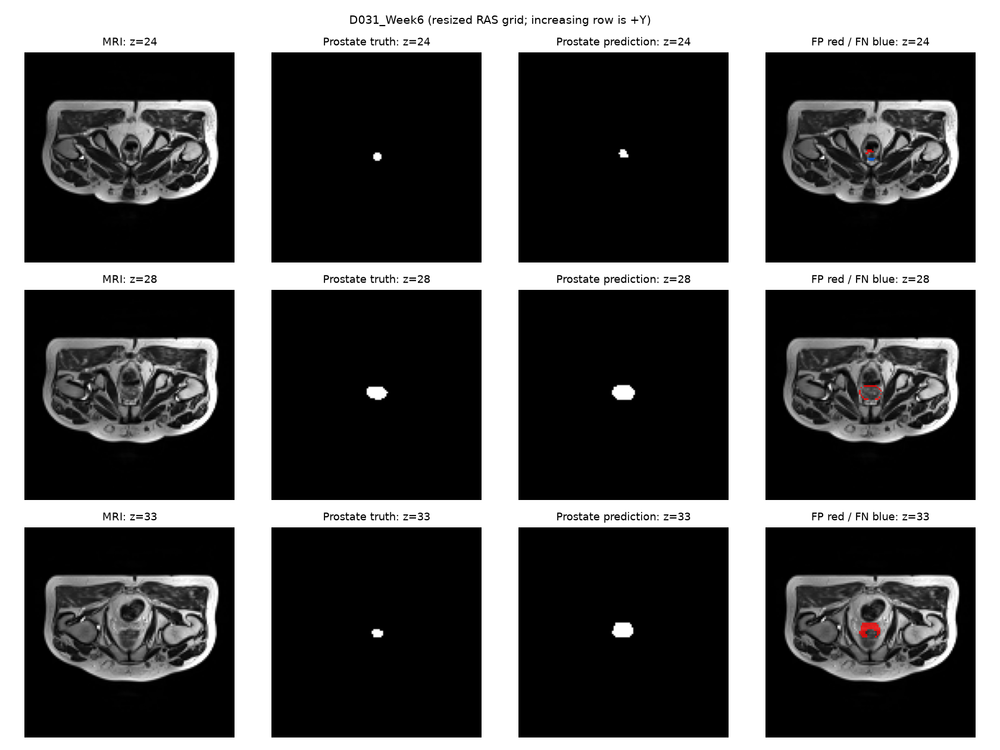
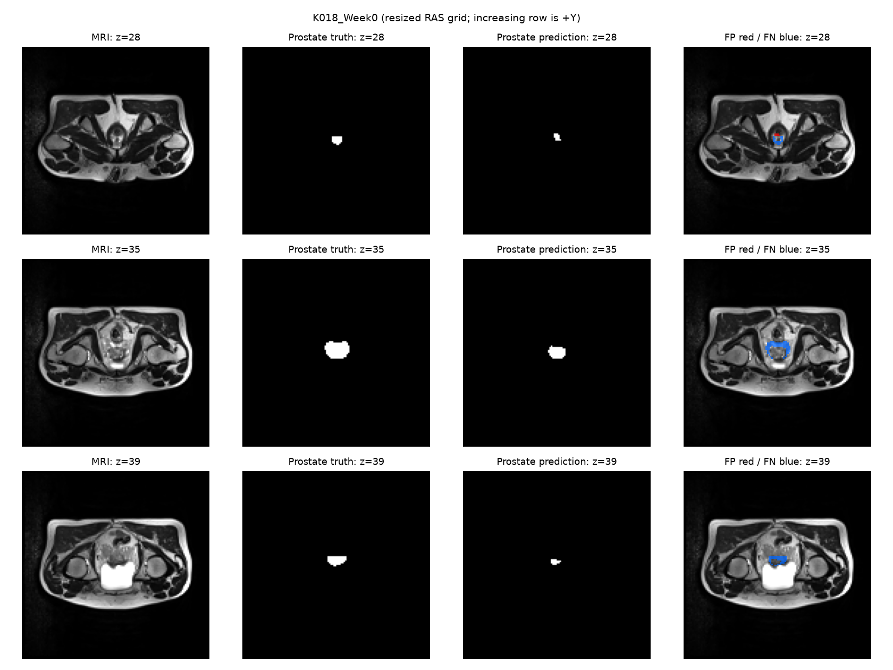

# HipMRI Prostate Segmentation: CAN3D versus a 2D U-Net Baseline

Xiaotian Mao | s4919055 | COMP3710, Semester 2, 2026

**Working report draft - completed work through 28 October 2026.** The implemented model is a 2D U-Net. A CAN3D adaptation now has a local forward/backward-tested prototype; its real GPU feasibility check and full training are pending. All reported segmentation scores below are training diagnostics or validation results; no final test results or 2D-versus-3D performance claims are available.

**Latest verified result:** the 2D U-Net best checkpoint is epoch 7, with full-validation patient-macro prostate Dice **0.6945** and IoU **0.5356**, independently rechecked in job 709282. These are validation results, not final test scores.

## 1. Problem and research question

This project investigates automatic organ segmentation in pelvic MRI, with prostate segmentation as the main outcome. The intended prototype would draft contours for an imaging specialist to review. Missing a small organ can make a high average score misleading, so the investigation considers each anatomical class and visible failure cases rather than background accuracy alone.

The planned comparison asks whether CAN3D's volumetric context improves prostate boundaries and continuity enough to justify its memory and inference cost compared with a standard 2D U-Net. The completed work establishes the data pipeline, implements the baseline and investigates why early training misses small organs. It does not yet answer the 3D comparison question. The planned acceptance criteria are preserved in Appendix A; they are targets, not achieved results.

## 2. Dataset and preprocessing

### 2.1 Source, labels and data integrity

The course-provided HipMRI data are stored on Rangpur under `/home/groups/comp3710/HipMRI_Study_open`. MRI files in `semantic_MRs` are paired with manual segmentation files in `semantic_labels_only` using the patient/week filename stem. There are 211 paired scans and 38 filename-derived patient groups. The publisher describes Week0 as pre-treatment and Weeks1-7 as weekly scans during radiotherapy [3,4].

| Code | Anatomical class |
|---|---|
| 0 | Background |
| 1 | Body |
| 2 | Bones |
| 3 | Bladder |
| 4 | Rectum |
| 5 | Prostate |

All 211 pairs passed the recorded content audit: paired spatial dimensions and affines agreed, MRI intensities were finite, and mask codes were valid integers from 0 to 5. Each original mask contained all six codes. Of the scans, 210 had dimensions 256 x 256 x 128; K019_Week1 had depth 144 and was retained. The original arrays used LPS orientation. Training scans had in-plane spacing from 1.40625 to 1.875 mm and through-plane spacing near 1.56 mm. These checks establish file integrity, not the clinical correctness of every annotation.

The training-set audit found 1,187,172 prostate voxels, approximately 0.104% of training voxels. This is evidence of class imbalance. A local PNG archive containing brain images was excluded because it was not the selected HipMRI dataset.

### 2.2 Patient-level experimental split

| Split | Patient groups | Scans | Purpose |
|---|---:|---:|---|
| Training | 26 | 136 | Parameter updates |
| Validation | 6 | 48 | Select checkpoints and investigate settings |
| Test | 6 | 27 | Reserved for final evaluation |
| Total | 38 | 211 | Complete paired inventory |

The split was generated with seed 42. All weeks from the same filename prefix remain together, preventing repeat scans from crossing groups. Membership, naming consistency and the manifest hash were checked. The grouping assumes that the prefix represents patient identity; it does not independently establish biological identity beyond the supplied filenames. The split has not been changed in response to model scores. File-integrity auditing included the dataset inventory, while model-development experiments have used training and validation data only.

### 2.3 Implemented preparation

Each aligned MRI/mask pair is reoriented to RAS, and array axes are converted from NIfTI X,Y,Z to PyTorch depth,height,width. Each MRI is standardized using its own mean and population standard deviation, with a small denominator clamp for constant images. There are no pooled validation/test normalization statistics.

The complete field of view is resized to 64 x 128 x 128 voxels. MRI intensities use trilinear interpolation; masks use nearest-exact interpolation on the corresponding voxel-centre grid, retaining integer labels. Masks become six-channel one-hot targets. The output affine and original geometry are retained. This is a fixed voxel shape, **not common physical voxel spacing**. Resizing can remove fine boundary detail, especially for small organs. No label-guided crop is used for inference. The optional paired-flip augmentation is disabled in the reported runs.

## 3. Implemented model and evaluation

### 3.1 Standard 2D U-Net baseline

The implemented network follows the encoder-decoder and concatenated skip-connection design of U-Net [1]. Four encoder levels extract features using two padded 3 x 3 convolutions with ReLU, followed by 2 x 2 pooling. A bottleneck is followed by four decoder levels using transposed convolutions, concatenated encoder features and two convolutions. A 1 x 1 output convolution produces six raw class logits per pixel.

The initial channel width is 16, giving encoder/bottleneck widths 16,32,64,128,256. This reduces the original paper's channel count. Padded convolutions preserve dimensions rather than reproduce the original valid-convolution cropping. The network has **1,940,902 trainable parameters** and uses no pretrained weights. Each 3D case is processed slice by slice; all predictions are reassembled before case-level evaluation. The local CAN3D prototype is described in Section 3.4. No trained CAN3D results are available.



### 3.2 Training and checkpoint selection

Reported experiments use Adam with learning rate 0.001, a slice batch size of 8 and seed 42. The original loss is one minus the equally weighted mean soft Dice over six classes, including background. Softmax is applied inside the loss. Smoothing is 1e-6. The training loop performs forward prediction, loss calculation, gradient clearing, backpropagation and an optimizer step, following the course workflow [5]. Validation uses evaluation mode with no gradient updates.

`best.pt` is selected by validation patient-macro prostate Dice. `last.pt` retains the current weights, Adam state, completed epoch and history. Resumption preserves the earlier best checkpoint and refuses incompatible settings. With zero prostate Dice at every epoch, the retained best can be the earliest checkpoint; therefore the diagnostic prediction panels use `last.pt` from the three-epoch balanced run.

### 3.3 Metrics and safeguards

For each class, hard predictions are compared with the full reassembled volume:

```text
Dice = 2 TP / (2 TP + FP + FN)
IoU  = TP / (TP + FP + FN)
```

If both prediction and truth are empty, that class is recorded as missing and excluded from its mean; if only one is empty, its score is zero. Scores are averaged over scans within each patient and then equally over patients. This prevents frequently scanned patients dominating the main result. Scan-macro scores are also stored. The test driver requires explicit final-test authorization and a fixed fitted checkpoint; it has not been run on real test data.

### 3.4 Local CAN3D prototype and course-based training plan

`can3d.py` implements the methods-text one-downsampling variant of CAN3D [2]: 1-to-8 stem, stride-2 projection to 36 channels, context dilations 2/4/8/1 with 48 latent channels, transposed upsampling and an element-wise shortcut sum before six class logits. Each block uses convolution, learned identity/instance-normalization blending and LeakyReLU(0.1). Context kernels start with center-tap identity mappings; ordinary kernels use Xavier uniform initialization. The prototype has **170,342 parameters**.

The paper's Figure 2 instead illustrates a two-downsampling variant with 3/6/36/48 channels. Our smaller resized input uses the one-downsampling option described in the methods, not an exact reproduction of that diagram. The 8-channel shortcut/upsampling output, transposed-convolution padding, initial normalization weights (a=1,b=0) and non-affine instance normalization are explicit implementation choices. Outputs are raw logits because the loss handles softmax internally.

The initial planned recipe uses the same saved patient split, preprocessing, Adam learning rate 0.001 and unit-weight Dice+CE ingredients as the successful baseline, but processes one whole resized volume per update. It does not reproduce the paper's specialized DSF objective, scheduler or augmentation. These differences and the different update counts must remain visible in the final comparison. Three local tests passed for initialization, normalization, full-volume shapes, finite gradients and an actual optimizer update; this does not establish GPU memory, epoch duration or accuracy. The prepared `can3d_smoke.slurm` measures five steps on one training volume (two warmup, three measured); validation and test data are not opened. Full training/inference integration remains pending.

## 4. Experiments completed so far

| Run | Experiment | Completed work | Main observation |
|---|---|---:|---|
| 700021 | Short training on selected slices | 100 steps | Training/reload and prediction checks passed |
| 703884 (A) | All training slices, Dice loss | 25 of 30 | Two-hour timeout; validation prostate Dice stayed zero |
| 704488 (B) | Balanced training slices, Dice loss | 3 | Rectum learned partially; bladder/prostate predictions absent |
| 708234 (C) | Continue B with the same settings | 4-8 | Completed; bladder/prostate predictions still absent |
| 708618 (D) | Balanced slices, Dice + cross-entropy | 3 | Prostate validation Dice reached 0.6243 |
| 709041 (E) | Continue D without changing the recipe | 4-8 | Best epoch 7: prostate Dice 0.6945; epoch 8: 0.6060 |
| 709282 | Re-evaluate fixed E best checkpoint | 48 validation scans | Epoch 7, matching checkpoint hash and score; three case panels |

Run A visits every training slice once each epoch. Runs B/C use all 136 training cases but draw half of each case's slice budget from slices containing prostate and half from slices without it. Positive slices may repeat, and not every original slice is visited that epoch. With batch size 8, interleaving gives four positive and four negative slices when both groups exist. The fallback for a case with only one group is to use every slice once. Validation always uses complete volumes. Each balanced epoch recorded 4,352 positive slices among 8,704 draws.

These experiments investigate training failure, rather than provide a final controlled model comparison. Run A has 25 epochs and the fully downloaded B report has 3; their different budgets and sampled training distributions limit causal conclusions. Run C preserves B's training recipe and adds five epochs. Its numbers here come from the student's terminal output; its detailed JSON report has not yet been downloaded.

Runs B and D provide a matched three-epoch objective comparison. Both use the same architecture, initial seed, input shape, fixed split, balanced sampling, batch size and Adam learning rate. D adds mean per-pixel categorical cross-entropy to soft Dice, with coefficient 1 for each. Both ingredients are covered in Contact 6/7; their sum is a project adaptation. The architecture and original Dice code were checked to be unchanged, and D's recorded source hashes match the local code. Both devices are A100-PCIE-40GB GPUs, on different nodes. This is a single-seed pilot comparison, not a statistical guarantee across runs.



The short debug run reached prostate Dice 0.8743 on a few selected training slices, but its complete training-case preview scored 0.2814. These different scopes demonstrate why a selected-slice debug score cannot serve as a validation or test result.

## 5. Preliminary results and analysis

### 5.1 Per-class whole-volume validation

The following patient-macro results cover the same 48 validation scans from six groups. A is the last completed epoch 25; B and D are epoch 3. They are preliminary validation results, not final test scores or a CAN3D comparison.

| Class | A Dice | A IoU | B Dice | B IoU | D Dice | D IoU |
|---|---:|---:|---:|---:|---:|---:|
| Background | 0.9966 | 0.9933 | 0.9932 | 0.9865 | 0.9953 | 0.9906 |
| Body | 0.9777 | 0.9565 | 0.9551 | 0.9146 | 0.9624 | 0.9279 |
| Bones | 0.9006 | 0.8194 | 0.7216 | 0.5658 | 0.7307 | 0.5774 |
| Bladder | 0.0000 | 0.0000 | 0.0000 | 0.0000 | 0.7137 | 0.5880 |
| Rectum | 0.0000 | 0.0000 | 0.5600 | 0.3958 | 0.5684 | 0.4045 |
| Prostate | 0.0000 | 0.0000 | 0.0000 | 0.0000 | 0.6243 | 0.4602 |

In A, the model predicted only background, body and bones. The validation truth contained 49,917 prostate voxels, but the prediction contained zero. Bladder and rectum were also completely omitted. Thus falling overall training loss did not establish useful small-organ segmentation.

In B, rectum Dice reached 0.5600, with 114,516 predicted rectum voxels against 67,549 true voxels. This indicates partial overlap, with substantial errors still present. Prostate and bladder predictions remained empty. At epoch 8 in C, prostate Dice was still displayed as 0.000000 and predicted prostate voxels were zero. More epochs and balanced slices alone did not resolve that failure.

In D, prostate Dice increased from 0.3704 to 0.4375 to **0.6243**, with epoch-3 IoU 0.4602. Bladder Dice reached 0.7137 and rectum Dice 0.5684. Prostate predictions totalled 74,738 voxels against 49,917 true voxels, so nonempty output is not evidence of accurate boundaries or absence of over-segmentation. The matched B/D comparison supports the additional CE term as a useful change in this pilot; it does not prove one sole mechanism behind the earlier failures. Small targets, downsampling and optimization remain relevant limitations.



Cross-entropy receives raw logits and integer class labels, while the Dice term uses softmax probabilities. Since the combined objective has a different numerical scale, its loss should not be compared directly with Dice-only loss. The validation report preserves both the combined objective and soft Dice loss separately. The promising validation result is not a final test result or evidence that the planned model target has been achieved.

The continuation E retained the saved weights and Adam state from D. Prostate validation Dice for epochs 4-8 was 0.6454, 0.5940, 0.6627, **0.6945**, 0.6060. Training loss kept falling, but validation overlap did not improve monotonically. The last epoch therefore must not replace the validation-selected best checkpoint. This short history does not establish a sole cause of the fluctuations.

Job 709282 reloaded the unchanged best checkpoint, confirmed epoch 7 and reproduced its score on the same 48 validation scans. All class metrics below belong to **that same epoch-7 checkpoint**; they must not be mixed with the epoch-8 latest report. Its SHA256 is `094deac975b46ecd9c0fa497d9581fd188d120bd34c318b9897e6bf3239a303c`. The epoch-7 prostate prediction totals 61,897 voxels against 49,917 truth voxels. Per-case results were independently re-aggregated by patient.

| Class | Best epoch-7 Dice | Best epoch-7 IoU |
|---|---:|---:|
| Background | 0.9945 | 0.9891 |
| Body | 0.9733 | 0.9482 |
| Bones | 0.8413 | 0.7273 |
| Bladder | 0.8235 | 0.7154 |
| Rectum | 0.7615 | 0.6211 |
| Prostate | 0.6945 | 0.5356 |

### 5.2 Observed error cases

The downloaded prediction panels and NIfTI counts agree. Both examples use the same failed Dice-only epoch-3 checkpoint from B and the resized RAS grid; see Appendix B. They are historical diagnostic failures, not predictions from D, and **not the completed requirement for 3-5 representative final-model failures**. Three current best-checkpoint validation cases are analysed below and illustrated in Appendix C.

**Training case B006_Week0:** the manual prostate contains 1,287 voxels and the model predicts none. Prostate Dice is zero; rectum Dice is 0.5680. The displayed first, largest and last labelled prostate slices are all missed. Because an already-seen training case fails too, this cannot be explained solely as poor performance on a new patient.

**Validation case C032_Week0:** the manual prostate contains 683 voxels and the prediction again contains none. Prostate Dice is zero; rectum Dice is 0.3710. The complete omission also affects the largest labelled prostate slice, so the problem is broader than a small boundary discrepancy on an extreme slice.

The panels show visible annotations at MRI locations with no obvious global offset in these examples. This is a limited visual check, not proof that all annotations or preprocessing are correct. Blue overlays show false negatives. The first/last labelled slices are not assigned clinical base/apex labels without further anatomical verification. No case was selected from the final test set.

The current cases were selected reproducibly by lowest prostate Dice, taking one scan from each of three distinct validation patient groups. They illustrate error modes; they are not a random sample or final test cases. Full-volume TP/FP/FN counts below were recovered from the exact overlap/count records, while the panels show first, largest and last labelled slices.

**C032_Week0: excess prediction at small extents.** Dice 0.5321, IoU 0.3625; 683 true versus 1,749 predicted voxels, with TP/FP/FN = 647/1,102/36. The first/last displayed slices have much larger predicted masks than their small labels; the central slice has both excess and missed regions. Most error volume is false positive. A plausible trigger is uncertain small-organ extent after resizing, but this is a hypothesis rather than a proven anatomical diagnosis.

**D031_Week6: high coverage with an oversized contour.** Dice 0.5932, IoU 0.4217; 512 true versus 1,167 predicted voxels, TP/FP/FN = 498/669/14. The largest displayed slice covers most of the label but adds a surrounding region; the last labelled slice also shows excess prediction. Missing voxels are few over the full case, so further reducing false negatives alone would not address its main failure.

**K018_Week0: substantial under-segmentation.** Dice 0.5991, IoU 0.4277; 1,349 true versus 931 predicted voxels, TP/FP/FN = 683/248/666. The larger and last displayed labelled slices show a smaller predicted region with broad blue missed areas. This opposite error mode means a blanket shrinking of every prediction to fix the first two cases could worsen this case. Slice-wise context limitations, contrast and resolution loss are candidate triggers; comparing 3D context under the same split is a planned investigation, not a measured improvement.

The three-case inspection supports retaining patient-specific boundary analysis alongside mean overlap. It does not prove label noise, establish clinical base/apex identity, or complete the remaining CAN3D/final-model assessment.

### 5.3 Resource observations

| Measurement | Observation | Scope and limitation |
|---|---|---|
| U-Net parameters | 1,940,902 | Implemented 2D model |
| Peak training allocation | A/B: 167.34 MiB; D: 166.71 MiB | PyTorch allocation; excludes driver/context and other device memory; small differences do not establish a memory advantage |
| A100 complete-case preview | 0.2223 s (debug); 0.2216 / 0.2264 s (best model) | Individual training/validation previews; no disk/plot time; not repeated benchmark |
| CPU complete-case previews | 2.6096 / 1.7711 s | Two diagnostic cases, run 704533; different device/checkpoint |
| CAN3D resources | 170,342 parameters; real GPU allocation/time pending | Local one-downsampling prototype; no trained-model measurements |

The A100 observations were obtained on an NVIDIA A100-PCIE-40GB. These are descriptive diagnostic measurements. They do not constitute repeated, controlled latency measurements or comparable 2D/3D resource profiling. The tiny CUDA check's 0.174 MiB allocation is excluded because it did not run the U-Net. CPU preview times must not be compared directly with A100 timings to claim a model advantage.

### 5.4 Engineering recommendation at this stage

**Do not deploy the current prototype for automatic prostate contour drafting.** Dice+CE has recovered prostate predictions and is a promising baseline recipe, but best mean validation Dice 0.6945 on six groups is not sufficient evidence for reliable contours. Its boundaries, error cases and fixed-model test performance still need examination. Retain the verified data pipeline and failed-run evidence, retain the inspected error examples and compare the selected baseline with the planned 3D model. Any later usable prototype would still require specialist review.

There is currently no evidence that CAN3D improves accuracy or efficiency, because its local prototype has not been trained or evaluated on real data. A final recommendation between 2D and 3D must wait for both trained models, the same fixed test split, comparable resource measurements and sufficient failure-case analysis. The selected Hard route and target Dice are not achieved by selecting the model name or by passing a GPU smoke test.

## 6. Implementation, reproducibility and verification

### 6.1 Code organization

| File | Implemented responsibility |
|---|---|
| modules.py | 2D U-Net, soft Dice and optional Dice+CE objective; PyTorch only |
| can3d.py / can3d_smoke.py | Local CAN3D adaptation and a training-only GPU feasibility diagnostic |
| dataset.py | Inventory, patient split, integrity checks, aligned preparation and slice conversion |
| train.py | Debug/fit/validation, checkpoint selection/resumption and guarded final-test driver |
| predict.py | Reload weights, predict complete cases and save masks/error panels |
| experiment.py | Reproducibility helpers, hard metrics, case/patient aggregation and plotting |
| validate_best.py | Fixed-checkpoint validation recheck and distinct-patient low-score panels |
| test_dataset.py / test_modules.py / test_experiment.py | Synthetic software and numerical verification |

Small aggregate evidence accompanies this report in [validation_summary.csv](results/validation_summary.csv) and [learning_history.csv](results/learning_history.csv). Downloaded raw reports, complete patient manifests and medical-volume files are kept outside the repository. Dataset and model-weight formats, runs and caches are ignored by Git.

### 6.2 Recorded environment and split

The downloaded A/B configurations record Python 3.11.16, PyTorch 2.14.0+cu130, CUDA package 13.0, NumPy 2.4.6 and NiBabel 5.4.2. The setup output recorded Matplotlib 3.11.2; that package's version was not serialized in those run configurations. This distinction should be retained when reproducing the older runs.

The fixed manifest SHA256 is `47a19c81dee93d9ddd2a920b86572bf57db240cc8a968ea731305d54a181d25e`. Each run records source hashes, model/input settings, seed, device, host and Slurm job ID. New output directories refuse overwrite, and manifests are checked for identity consistency and cross-split overlap. Runs A/B/D match the inspected manifest; A's original source hashes and D's current source hashes were independently checked. D's patient-macro metrics were independently recomputed from the case records. Later code changes are recorded in progressive commits. Bitwise reproducibility across different hardware or library versions is not assumed.

### 6.3 Example usage

Commands assume a checkout containing this draft's code. Raw data must be available through the course-provided location; checkpoints are generated by training, not committed. Heavy Python commands must run in a compute allocation rather than the shared login node.

Inside an allocated CPU shell with the course `torch` environment active, a fresh working directory can prepare the deterministic split:

```bash
mkdir -p runs
python dataset.py --split runs/split_seed42.json
python dataset.py --case B006_Week0
```

Keep an existing saved split; do not regenerate it in response to poor results. From the project directory on the login node, submit the reproduced three-epoch balanced pilot once:

```bash
sbatch baseline_balance_pilot.slurm
squeue --me
```

For job JOBID, training artifacts are under `runs/baseline_balance_JOBID/`. After generating a fit checkpoint, a validation preview can be produced inside a compute allocation:

```bash
python predict.py --device cpu --split validation \
    --checkpoint runs/baseline_balance_JOBID/last.pt \
    --output runs/validation_preview_JOBID
```

The output contains a prediction NIfTI on the resized RAS grid, a prostate input/truth/prediction/error panel and a small metrics JSON. A preview subset is not a full evaluation. The saved inspection script reproduces the two historical previews using checkpoint 704488. `baseline_dice_ce_pilot.slurm` reproduces the three-epoch D recipe; the prepared `baseline_dice_ce_resume.slurm` continues verified run 708618 to epoch 8 in a new directory, then generates training/validation previews using the validation-selected best weights. Run 709041 completed; its selected epoch-7 checkpoint was rechecked by `baseline_validate_best.slurm` in job 709282. Both launchers bundle reports/figures without model weights for a small diagnostic download.

### 6.4 Code verification and its limits

Twenty-four core local tests passed, using temporary synthetic fixtures. Two additional validation-driver tests passed: actual checkpoint reevaluation with test files removed, plus hash/overwrite safeguards and different-patient case selection. They cover coordinate/grid consistency, variable-depth handling, invalid labels/intensities, split leakage, one-hot targets, known-answer Dice/IoU, patient aggregation, finite gradients, actual small optimization runs, checkpoint reload/resumption, balanced batches, loss arithmetic and guarded test access. The test command is:

```bash
python -m unittest -v test_dataset test_modules test_experiment test_validate_best test_can3d
```

Three additional CAN3D prototype tests passed; their synthetic evidence is limited to the architecture and optimizer behavior, not real-data feasibility.

Separately, real evidence includes the full 211-pair audit, a three-case prepared-data check, an A100 CUDA check, GPU debug/fit runs and the downloaded case previews. Passing software tests verifies those checked behaviours, not segmentation quality. The student's ability to explain the code is distinct from generated tests or tutor explanations.

## 7. Remaining work and limitations

The current evidence is limited by a small validation cohort, filename-based identity grouping, downsampled anatomy, single-seed trials and a small, deliberately selected set of inspected error cases. A/B have unequal budgets; B/D have a matched three-epoch budget but no repeat-seed uncertainty estimate. Dice+CE improves validation overlap, but the main final-test objective remains unverified. The following results are intentionally not invented in this draft:

- Controlled profiling of the selected baseline, and assessment of any later changed model on fresh error examples.
- Full CAN3D training/inference integration, real GPU feasibility and a trained CAN3D model.
- Frozen-model test Dice/IoU and a direct 2D-versus-3D comparison.
- Controlled full-model resource profiling and final 2D/3D failure-case comparison; the current three baseline validation cases are preliminary evidence.

The student reported on 28 October that the compulsory check-off was completed and that the tutor gave no specific recommendations. Final PR/Turnitin submission and any required teaching-team code-review response remain separate from the completed consultation.

## 8. Artificial Intelligence Usage Disclosure

OpenAI Codex assisted with interpreting the specification and lectures, locating references, drafting/refactoring the PyTorch data/model/training/metric code, writing synthetic tests, inspecting downloaded reports and figures, and writing this report. Codex ran the local checks and made genuine milestone commits. The student executed the authenticated Rangpur commands, submitted jobs and supplied/downloaded their outputs. This is not a claim that all code was independently written or audited by the student.

Verification included source/manifest hashes, known-answer calculations, synthetic integration tests and the real experiments described above. Unsuccessful results are retained, and generated proposals are separated from measured outcomes. The student remains responsible for reviewing and understanding every submitted component and this draft's claims before submission. No fellow-student code, previous-year PR implementation or pretrained model has been incorporated in the current baseline.

## References

1. Ronneberger, O., Fischer, P. and Brox, T. (2015). [U-Net: Convolutional Networks for Biomedical Image Segmentation](https://arxiv.org/abs/1505.04597).
2. Dai, W. et al. (2021). [CAN3D: Fast 3D Medical Image Segmentation via Compact Context Aggregation](https://arxiv.org/abs/2109.05443). Selected main-model reference; implementation pending.
3. Dowling, J. and Greer, P. (2021). [Labelled weekly MR images of the male pelvis](https://doi.org/10.25919/45t8-p065). CSIRO Data Collection, version 2.
4. Dowling et al. (2015). [Automatic Substitute Computed Tomography Generation and Contouring for MRI-Alone External Beam Radiation Therapy From Standard MRI Sequences](https://doi.org/10.1016/j.ijrobp.2015.08.045). Data were provided by HipMRI Study; non-commercial educational use and acknowledgement follow the supplied data-use terms.
5. COMP3710 (2026). Contact 6: Neural Networks; Contact 7: ConvNets, Segmentation and Object Detection. Course teaching materials.
6. COMP3710 (2026). Final report assessment specification v2.5, Sections 2.2-6 and Appendices A-B. [Official announcement](https://edstem.org/au/courses/38242/discussion/3600790).
7. Teaching-team clarifications: [paper-style reporting and sources, #146](https://edstem.org/au/courses/38242/discussion/3630405); [failure-case analysis, #136](https://edstem.org/au/courses/38242/discussion/3613609); [recommendations, #214](https://edstem.org/au/courses/38242/discussion/3668050); [small result evidence, #238](https://edstem.org/au/courses/38242/discussion/3679712); [original check-off content, #193](https://edstem.org/au/courses/38242/discussion/3656727).

## Appendix A. Archived one-page feasibility review

The preparation copy below is reproduced unchanged from the archived review supplied for check-off preparation. Its historical statements describe what was known then; Sections 4-7 above provide subsequent updates. The consultation was reported complete on 28 October. The original Markdown is also retained as [feasibility_review_original.md](feasibility_review_original.md), following staff guidance to keep the check-off content as a supplement.

# HipMRI feasibility review

Prepared 26 October; consultation planned 27 October 2026.

**1. User Need, Scope & Acceptance Criteria**

Build an MRI contour-drafting prototype for an imaging specialist to review.
Compare whether CAN3D improves prostate boundaries enough to justify its cost over 2D U-Net.

Proposed acceptance targets:
- No overlap between patient groups across splits.
- Prostate test Dice at least 0.70; report per-class Dice and IoU.
- Inspect 3-5 real boundary failures with prediction/error overlays.
- Keep the 3D pilot below 35 GiB peak allocated memory on a 40 GB A100.
- Compare parameter count and inference time per complete case.

**2. Model Choice & Course Concepts**

- Model: planned CAN3D (Hard); implemented 2D U-Net baseline.
- Data: HipMRI, 211 scans and 38 filename-derived patient groups; train/validation/test = 26/6/6 groups.
- Shared preprocessing: z-score, aligned 64x128x128 pilot volumes and six-class masks; prostate is label 5.
- Course methods: convolution, dilation, skip connections, Adam and soft Dice. The training recipe is adapted to the course.

**3. Preliminary Feasibility Evidence**

- All 211 image/mask pairs passed integrity checks; three real training cases passed the resized loader check.
- A tiny A100 CUDA forward/backward test passed; baseline code passed 17 local synthetic tests.
- GPU baseline debug job 700021 is submitted; its result is unverified. CAN3D and full training/test results remain pending.

**4. Risks, Budget & Fallback**

- Risks: a small prostate class, loss of boundary detail during resizing and GPU queues.
- Next: inspect the 100-step baseline debug run, train the baseline, then implement CAN3D.
- Budget: one GPU; ten-minute debug allocation, then two-hour fit pilots; eight slices per 2D batch or one volume per 3D batch.
- Fallback: retain the tested 2D baseline. Adjust settings with validation data; use the test split only after choices are fixed.

**Code and AI disclosure.** Codex assisted with course- and paper-based PyTorch code, tests and this draft.
I ran the real-data checks and remain responsible for understanding and verifying the work.

## Appendix B. Diagnostic prediction panels

These are illustrative panels from two complete-case predictions using the failed Dice-only run 704488's last checkpoint. They are not predictions from the improved Dice+CE model. Columns show MRI input, manual prostate mask, predicted prostate mask and false-positive/false-negative overlays. Blue indicates missed prostate; red would indicate extra prostate. Rows show first, largest and last labelled prostate levels. These examples support the historical failure analysis in Section 5.2 and do not replace the final 3-5-case investigation.





## Appendix C. Selected best-checkpoint validation errors

All three panels use the same epoch-7 checkpoint, selected by validation patient-macro prostate Dice. Red marks false positives, blue false negatives. Selection is by lowest full-case prostate Dice with different patient groups, not three slices counted as three patients.






