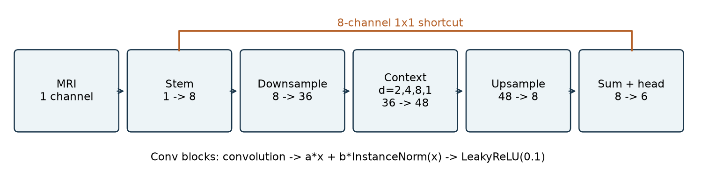
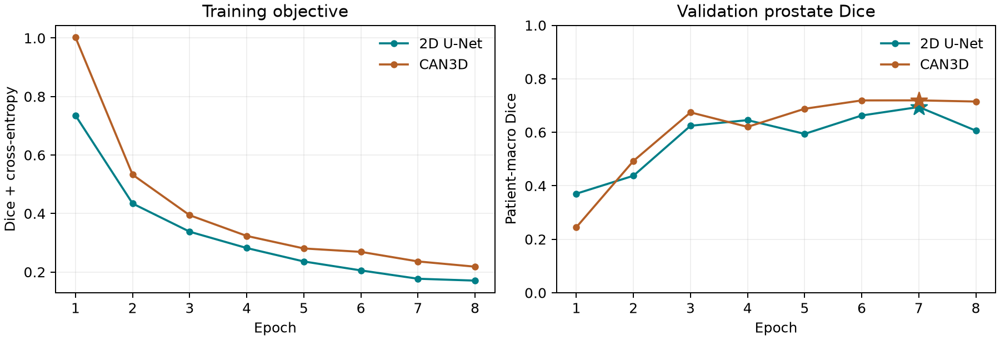
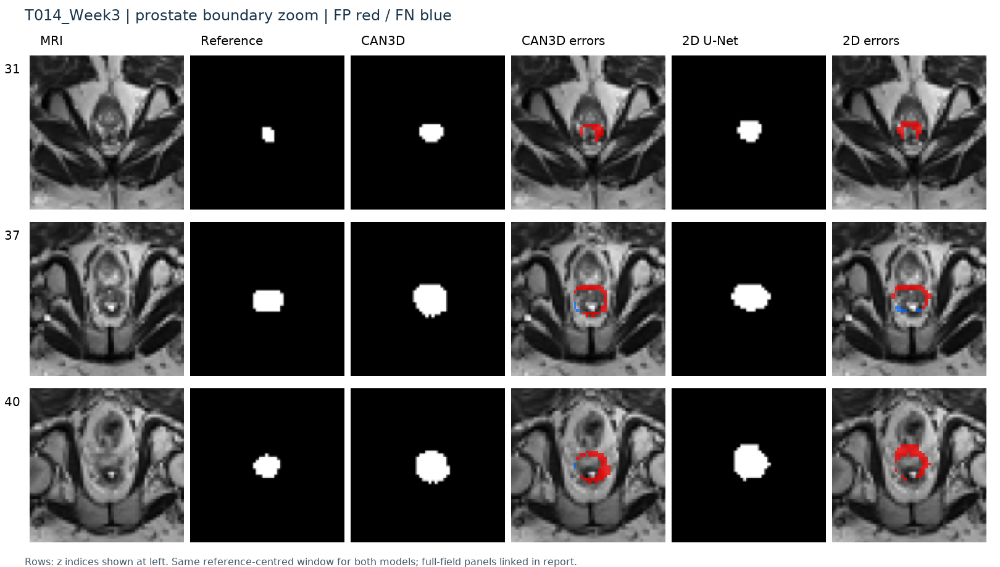
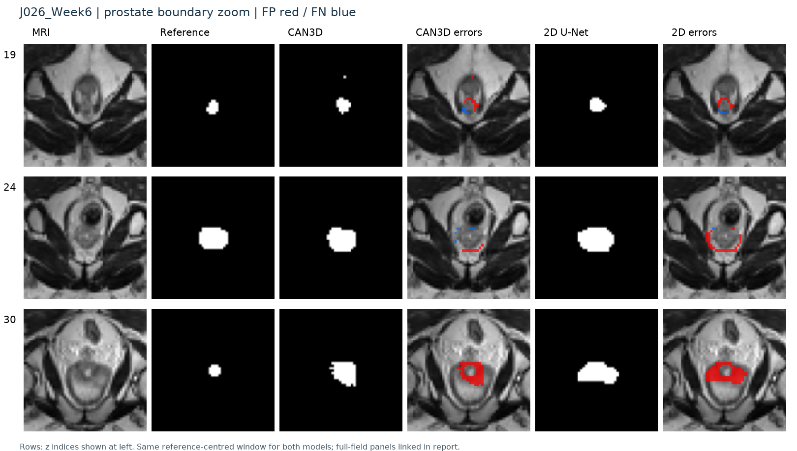
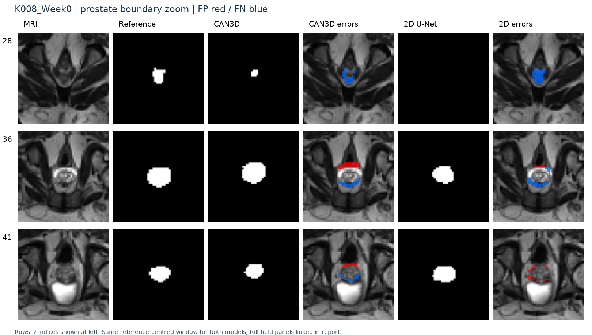
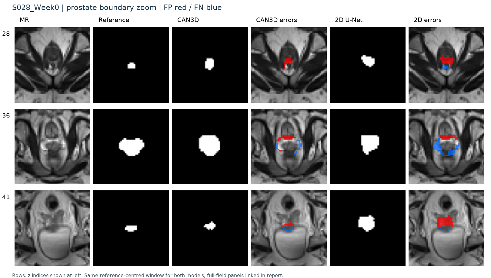
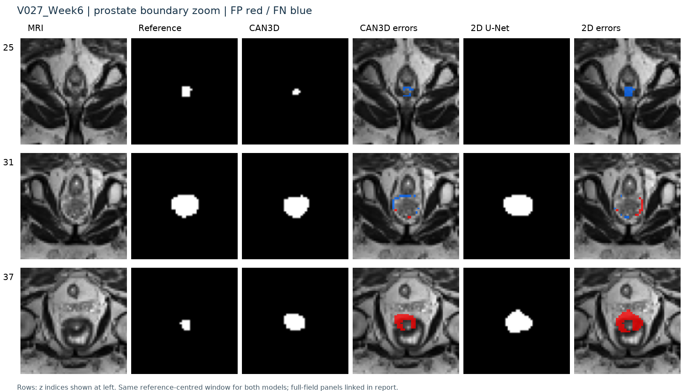

# HipMRI Prostate Segmentation: CAN3D versus a 2D U-Net Baseline

Xiaotian Mao | s4919055 | COMP3710, Semester 2, 2026 | 29 October 2026

## Abstract

This project compares a compact CAN3D adaptation with a standard 2D U-Net for six-class pelvic MRI segmentation. On a fixed test split of 27 scans from six patient groups, validation-selected CAN3D achieves patient-macro prostate Dice 0.7762 and IoU 0.6395, versus 0.7020 and 0.5482 for U-Net. CAN3D uses fewer parameters but 2.62 times the peak allocated inference memory; U-Net performs better on the other foreground classes. Five shared test cases reveal persistent excess and missed boundaries, supporting further supervised research rather than unattended contour generation.

## 1. Problem and research question

The task is to assign each pelvic MRI voxel to background, body, bones, bladder, rectum or prostate. A potential user is an imaging specialist who reviews draft organ contours. Small boundary errors can matter even when background overlap is high, so prostate overlap, each other class, visible failures and computational cost are evaluated separately.

The research question is whether whole-volume context in CAN3D improves prostate segmentation enough to justify its cost compared with slice-wise U-Net. The course Hard route specifies a prostate test Dice target of at least 0.70 [6]. Meeting this numerical target is evidence about this experiment, not clinical readiness or a guarantee of marks. The original feasibility criteria are preserved unchanged in Appendix A.

## 2. Dataset and preprocessing

### 2.1 Source, labels and data integrity

The course-provided HipMRI data are stored on Rangpur under `/home/groups/comp3710/HipMRI_Study_open`. MRI files in `semantic_MRs` are paired with manual segmentation files in `semantic_labels_only` using the patient/week filename stem. There are 211 paired scans and 38 filename-derived patient groups. The publisher describes Week0 as pre-treatment and Weeks1-7 as weekly scans during radiotherapy [3,4].

| Code | Anatomical class |
|---|---|
| 0 | Background |
| 1 | Body |
| 2 | Bones |
| 3 | Bladder |
| 4 | Rectum |
| 5 | Prostate |

All 211 pairs passed the recorded content audit: paired spatial dimensions and affines agreed, MRI intensities were finite, and mask codes were valid integers from 0 to 5. Each original mask contained all six codes. Of the scans, 210 had dimensions 256 x 256 x 128; K019_Week1 had depth 144 and was retained. The original arrays used LPS orientation. Training scans had in-plane spacing from 1.40625 to 1.875 mm and through-plane spacing near 1.56 mm. These checks establish file integrity, not the clinical correctness of every annotation.

The training-set audit found 1,187,172 prostate voxels, approximately 0.104% of training voxels. This is evidence of class imbalance. A local PNG archive containing brain images was excluded because it was not the selected HipMRI dataset.

### 2.2 Patient-level experimental split

| Split | Patient groups | Scans | Purpose |
|---|---:|---:|---|
| Training | 26 | 136 | Parameter updates |
| Validation | 6 | 48 | Select checkpoints and investigate settings |
| Test | 6 | 27 | Reserved for final evaluation |
| Total | 38 | 211 | Complete paired inventory |

The split was generated with seed 42. All weeks from the same filename prefix remain together, preventing repeat scans from crossing groups. Membership, naming consistency and the manifest hash were checked. The grouping assumes that the prefix represents patient identity; it does not independently establish biological identity beyond the supplied filenames. The split has not been changed in response to model scores. File-integrity auditing included the dataset inventory, while model-development experiments have used training and validation data only.

### 2.3 Implemented preparation

Each aligned MRI/mask pair is reoriented to RAS, and array axes are converted from NIfTI X,Y,Z to PyTorch depth,height,width. Each MRI is standardized using its own mean and population standard deviation, with a small denominator clamp for constant images. There are no pooled validation/test normalization statistics.

The complete field of view is resized to 64 x 128 x 128 voxels. MRI intensities use trilinear interpolation; masks use nearest-exact interpolation on the corresponding voxel-centre grid, retaining integer labels. Masks become six-channel one-hot targets. The output affine and original geometry are retained. This is a fixed voxel shape, **not common physical voxel spacing**. Resizing can remove fine boundary detail, especially for small organs. No label-guided crop is used for inference. The 2D baseline uses no augmentation; CAN3D applies training-only paired left/right flips, described below. Validation and test are never augmented.

## 3. Models and course-based training

### 3.1 2D U-Net baseline

The baseline follows U-Net's encoder-decoder structure with concatenated skip connections [1]. Four encoder stages each contain two padded 3x3 convolutions and ReLU, then 2x2 pooling. Channel widths are 16, 32, 64 and 128, with a 256-channel bottleneck. The decoder uses 2x2 transposed convolutions, matching encoder features and two convolutions at each level. A 1x1 head returns six raw logits. Padding avoids the original paper's valid-convolution cropping; reduced width is an explicit project adaptation. There are 1,940,902 trainable parameters and no pretrained weights.


### 3.2 CAN3D adaptation

`can3d.py` implements the one-downsampling option described in the CAN3D methods [2]. A 1-to-8 stem feeds a stride-2 projection to 36 channels. Four context blocks use dilations 2, 4, 8 and 1, with the last expanding to 48 channels. A transposed convolution upsamples to eight channels; an eight-channel 1x1 shortcut is added before a 1x1 six-class head. Dilated convolutions enlarge the receptive field without repeated pooling; the shortcut retains higher-resolution features. The network has 170,342 trainable parameters.

Each block applies convolution, learned scalar blending `a*x + b*InstanceNorm(x)`, and LeakyReLU(0.1). Initial a=1,b=0, non-affine instance normalization with epsilon 1e-5, shortcut/output widths and transposed-convolution padding are declared project choices. Ordinary kernels use Xavier uniform initialization; context kernels use centre-tap identity initialization, with extra output channels zeroed. The head returns raw logits.

The paper's Figure 2 shows a different two-downsampling, 3/6/36/48-channel variant. This implementation uses the methods-text 8/36/48-channel option for the smaller input volume and is not an exact Figure 2 reproduction. It also does not reproduce the paper's specialized DSF objective or scheduler. These adaptations are explicit to avoid attributing published-paper accuracy to this code.



### 3.3 Loss, optimization and data sampling

Both final recipes use Adam at learning rate 0.001 and seed 42. The forward-loss-zero-grad-backward-step workflow, convolution, skip connections, Dice and categorical cross-entropy follow Contact 6/7 concepts [5]. The combined objective is a project choice:

```text
soft_Dice_c = (2 sum(p_c * y_c) + 1e-6) / (sum(p_c) + sum(y_c) + 1e-6)
loss = (1 - mean_over_six_classes(soft_Dice_c)) + mean_cross_entropy
```

Dice is equally weighted across six classes, including background. Cross-entropy receives raw logits and integer class targets; both loss terms have coefficient 1. There are no class weights, pretrained models or test-dependent post-processing rules.

| Setting | 2D U-Net | CAN3D |
|---|---|---|
| Training input | Individual axial slices | Complete resized volumes |
| Batch size | 8 slices | 1 volume |
| Sampling per epoch | 8,704 draws; 4,352 prostate-positive | All 136 training volumes |
| Optimizer steps per epoch | 1,088 | 136 |
| Augmentation | None | Paired image/mask left-right torch.flip, probability 0.5 |
| Completed epochs / selected epoch | 8 / 7 | 8 / 7 |

Balanced slice sampling gives small-organ slices more opportunities to contribute; it does not alter validation or test membership. CAN3D flips only during training and updates spatial metadata consistently. The different sampling, augmentation and update counts mean this is a comparison of two implemented recipes, not an architecture-only ablation.

### 3.4 Validation, resumption and test freeze

`best.pt` is selected by patient-macro validation prostate Dice; `last.pt` retains weights, Adam state, history and epoch. Resume guards reject incompatible model, split, grid, loss, learning rate, sampling and augmentation settings. Earlier best weights survive resumption. Both selected epoch-7 models were independently revalidated on all 48 validation scans: U-Net Dice/IoU 0.6945/0.5356; CAN3D 0.7193/0.5709. Epoch-8 metrics were not substituted for the selected checkpoints.

The committed [final evaluation plan](final_evaluation_plan.json) fixed the two checkpoint hashes, original patient split, input grid and profiling settings before test scores were read. Job 710105 evaluated both fixed models without parameter updates. The test set is not used for further tuning. Historical baseline sources were checked against preserved revision 50e8ee7; the newer evaluation source hashes are recorded separately in the frozen plan.

## 4. Experimental design and metrics

### 4.1 Quantitative protocol

Hard argmax predictions are compared against complete reassembled reference volumes on the same resized RAS grid. For each class:

```text
Dice = 2 TP / (2 TP + FP + FN)
IoU  = TP / (TP + FP + FN)
```

If prediction and reference are both empty, the class is missing and excluded from its mean; if only one is empty, the score is zero. The primary metric first averages scans within each patient, then equally averages patients. This prevents repeated weeks dominating the comparison. Scan-macro metrics and individual cases are also saved. There are only six held-out groups and one training seed; no statistical significance claim is made.

### 4.2 Controlled inference cost measurement

Both models run in separate processes in one allocation on `a100-8`, an NVIDIA A100-PCIE-40GB, with one CPU thread and deterministic cuDNN policy. CAN3D runs first, U-Net second. Each test case has two warmups and three measured repetitions; predictions agree across repetitions. The table reports the mean across cases of each case's median time. No data loading or plot generation occurs within a timed repetition.

Timing starts with an already preprocessed CPU tensor and ends with a complete CPU hard mask. It includes host/device transfers, model execution, slice reassembly and CPU argmax, and excludes disk access, preprocessing, metric computation and figures. CUDA is synchronized around measurements. Peak allocated and reserved values are PyTorch memory statistics after warmup, including model and inference tensors but excluding driver/context and other processes. They are not total GPU-board usage.

## 5. Results

### 5.1 Training investigation

The initial all-slice Dice-only U-Net reached 25 epochs before its two-hour allocation timed out; validation prostate Dice remained zero. A three-epoch balanced-slice Dice-only trial also gave zero prostate Dice. Adding cross-entropy in a fresh matched three-epoch balanced trial raised prostate validation Dice to 0.6243. The architecture, initialization seed, split, grid, batch and sampling matched the three-epoch Dice-only trial, so this pilot supports the added objective term as useful here. It does not prove a unique cause for the earlier collapse or generalize across seeds. A later Dice-only continuation still had zero prostate Dice at epoch 8, supporting the decision to inspect the objective rather than only train longer.

The final Dice+CE U-Net and CAN3D runs both completed eight epochs. The validation-selected epoch is 7 for each. Historical validation tables and curves remain in [results/validation_summary.csv](results/validation_summary.csv) and [results/learning_history.csv](results/learning_history.csv); detailed continuation evidence is linked in the evidence index.



### 5.2 Final held-out accuracy

All 27 scans from the original six test groups were evaluated for both models. Values below are patient-macro means, not training or validation scores.

| Class | U-Net Dice | CAN3D Dice | U-Net IoU | CAN3D IoU |
|---|---:|---:|---:|---:|
| Background | 0.9952 | 0.9952 | 0.9905 | 0.9905 |
| Body | 0.9766 | 0.9716 | 0.9543 | 0.9447 |
| Bones | 0.8680 | 0.8195 | 0.7671 | 0.6948 |
| Bladder | 0.9029 | 0.8615 | 0.8269 | 0.7647 |
| Rectum | 0.7903 | 0.7204 | 0.6576 | 0.5663 |
| Prostate | 0.7020 | 0.7762 | 0.5482 | 0.6395 |

CAN3D improves prostate Dice by 0.0742 (7.42 percentage points), exceeding the Hard route's 0.70 target under the declared aggregation. U-Net has higher Dice and IoU for body, bones, bladder and rectum. The unweighted mean Dice across labels 1-5 is 0.8480 for U-Net and 0.8298 for CAN3D. Thus a prostate advantage does not establish general superiority across pelvic structures.

At patient level, CAN3D has higher prostate Dice in five of six groups; J026 is an exception (0.7253 versus U-Net 0.7686). The remaining group pairs (CAN3D/U-Net) are K008 0.7564/0.6071, S028 0.7882/0.7038, T009 0.8493/0.7803, T014 0.6886/0.5888 and V027 0.8493/0.7634. A single high aggregate must not hide that variation. Full precision class and case values are in the linked result CSVs.

### 5.3 Resource trade-off

| Resource, same final test allocation | 2D U-Net | CAN3D |
|---|---:|---:|
| Trainable parameters | 1,940,902 | 170,342 |
| Peak PyTorch allocated inference memory, MiB | 74.928 | 196.663 |
| Peak PyTorch reserved inference memory, MiB | 92.0 | 282.0 |
| Mean of per-case median inference time, seconds | 0.21961 | 0.21060 |

CAN3D has about 91.2% fewer parameters but uses 2.62 times the allocated inference memory, because parameter count does not describe full volumetric activation storage. It is about 4.1% faster on the measured CPU-input-to-CPU-mask path in this allocation; no general speed advantage or GPU-compute-only comparison is inferred. Fixed process order and caching also limit this comparison. Both peaks are well below the original 35 GiB feasibility budget. Historical training peaks and epoch times are different quantities and are not mixed into this inference table.

## 6. Five shared failure-case autopsies

Cases are the lowest prostate-Dice CAN3D scan from each of five different test groups, selected by a rule fixed before testing; U-Net uses the identical cases. They are low relative to other CAN3D test cases, not all complete segmentation failures. Counts below cover the entire resized 3D volume, so they are not counts from only the displayed slices.

| Test case | U-Net Dice | CAN3D Dice | U-Net FP / FN | CAN3D FP / FN |
|---|---:|---:|---:|---:|
| T014_Week3 | 0.5049 | 0.6102 | 823 / 40 | 570 / 19 |
| J026_Week6 | 0.7047 | 0.6340 | 548 / 11 | 686 / 45 |
| K008_Week0 | 0.6071 | 0.7564 | 361 / 545 | 358 / 270 |
| S028_Week0 | 0.7038 | 0.7882 | 517 / 292 | 435 / 155 |
| V027_Week6 | 0.7452 | 0.8044 | 330 / 206 | 205 / 186 |

The panels show the first, largest-reference-area and last labelled prostate slices. The same reference-centred display window is used for both models to make boundaries readable; this is visualization after full-volume inference, not label-guided model cropping. Full-field panels are linked for each case. First/last labelled levels are proxies for terminal boundary inspection, not independently confirmed clinical base/apex labels. Red is false positive and blue is false negative.

### 6.1 T014_Week3: Excess contour across small and central sections

CAN3D predicts 1,031 prostate voxels against 480 reference voxels; 570 are false positives. Red surrounds the small first labelled slice (z31), the largest slice (z37) and terminal slice (z40). U-Net is still more expansive (823 FP), but CAN3D has not solved the over-contouring failure.

A small target with coarse resized boundaries is consistent with these errors; similar-looking neighbouring tissue may also contribute, but the images do not establish its identity or causality. Review all terminal contours manually. Future work should assess a higher-resolution grid and per-slice boundary errors on development data and a new held-out cohort.



Full-field panels: [CAN3D](figures/final_can3d_T014_Week3.png), [2D U-Net](figures/final_unet2d_T014_Week3.png).

### 6.2 J026_Week6: A counterexample to a universal 3D benefit

CAN3D Dice is 0.6340, below U-Net 0.7047. The first labelled slice has both missed and excess regions; the final labelled slice z30 is enlarged. CAN3D has 686 FP and 45 FN, versus U-Net 548 FP and 11 FN. A six-neighbour 3D component count finds a 1,312-voxel main CAN3D component and seven isolated predicted voxels; U-Net has components of 1,183, 16, 15 and 1 voxels. Small predicted islands are an additional failure pattern; no component filtering was applied.

Volumetric context can propagate an overly broad contour instead of correcting it. Local appearance and the different training recipes are plausible contributors, not proven mechanisms. This scan remains unsuitable for unattended drafting; investigate terminal extent and shape consistency before any deployment study.



Full-field panels: [CAN3D](figures/final_can3d_J026_Week6.png), [2D U-Net](figures/final_unet2d_J026_Week6.png).

### 6.3 K008_Week0: Missed small terminal section and displaced boundaries

The first labelled slice z28 is severely under-predicted by CAN3D and missed by U-Net. At z36 both models show red/blue bands rather than exact boundary agreement. CAN3D reduces full-volume FN from 545 to 270, with similar FP (358 versus 361), explaining the Dice increase without implying that terminal coverage is reliable.

This pattern is consistent with a small cross-section and loss of detail during resizing. No global MRI/mask misalignment was found in the file audit, but subtle annotation uncertainty was not independently adjudicated. Future evaluation should retain more spatial detail and measure terminal-slice misses; human review remains necessary.



Full-field panels: [CAN3D](figures/final_can3d_K008_Week0.png), [2D U-Net](figures/final_unet2d_K008_Week0.png).

### 6.4 S028_Week0: A reasonable whole-volume Dice hides local boundary displacement

Despite CAN3D Dice 0.7882, the first slice z28 has excess and missed regions; z36 shows opposing red/blue boundary bands, and the last labelled slice z41 is poorly matched. U-Net has a larger missed central region and a visibly enlarged terminal prediction. CAN3D improves FN (155 versus 292) while retaining 435 FP.

A large central overlap can dominate the volume score while small end sections remain wrong. Resizing and local contrast are hypotheses rather than measured causes. Do not accept the contour solely because its case Dice is near 0.8; inspect terminal slices and add surface/extent checks in a later independently evaluated study.



Full-field panels: [CAN3D](figures/final_can3d_S028_Week0.png), [2D U-Net](figures/final_unet2d_S028_Week0.png).

### 6.5 V027_Week6: Residual terminal errors even above Dice 0.80

CAN3D Dice 0.8044 is higher than U-Net 0.7452, yet z25 is partly missed and the final labelled slice z37 is substantially over-predicted by both models. The central z31 overlap is much stronger. CAN3D has fewer FP (205 versus 330) but still 186 FN, so a favourable case score does not mean an exact contour.

Small terminal areas contribute little to the full-volume overlap but are visible failure points. The present pipeline has no validated uncertainty rejection or extent constraint. Flag small end sections for manual correction; any future post-processing must be tuned on development data and tested on new patients, not retrofitted to these test cases.



Full-field panels: [CAN3D](figures/final_can3d_V027_Week6.png), [2D U-Net](figures/final_unet2d_V027_Week6.png).

## 7. Engineering recommendation and limitations

For a prostate-focused research prototype on this data distribution, carry CAN3D forward for supervised evaluation: it has higher held-out prostate Dice in five of six patient groups, a small parameter count and a modest absolute inference-memory requirement on the tested A100. Retain U-Net as a lower-memory comparator and a stronger option for the other evaluated foreground structures. This is a task-dependent choice, not a universal replacement recommendation.

Neither model is ready for unattended radiotherapy contour drafting. Excess contours in T014/J026 and missed or misplaced terminal sections in K008/S028/V027 require review and correction. A prospective imaging-specialist study should measure correction time and clinically important boundary errors before claiming operational benefit. Full-volume Dice and a course target cannot establish clinical safety or workflow utility.

The main limitations are six filename-derived test groups, one seed, no external-centre validation, differing training recipes/update counts, fixed voxel shape rather than uniform physical spacing, reduced spatial resolution and evaluation on the resized grid. No original-resolution accuracy, surface-distance result, annotation-consensus study, uncertainty calibration or statistical significance is claimed. Future changes should be validated on development data and evaluated using new held-out patients; the current test results will remain a fixed report, not tuning feedback.

## 8. Code, dependencies and reproducibility

### 8.1 File map and input/output contract

| File | Purpose |
|---|---|
| dataset.py | Pair/audit NIfTIs, create guarded patient split, aligned normalization/resizing, six-channel targets and paired augmentation |
| modules.py / can3d.py | U-Net, CAN3D adaptation and segmentation objectives |
| train.py | Debug/fit modes, Adam, validation selection and guarded checkpoint resumption |
| predict.py | Reload checkpoints, complete-case predictions, resized-RAS NIfTIs and error panels |
| experiment.py | Seeding, dispatch, hard overlap, aggregation and checkpoint helpers |
| validate_best.py | Independent validation-only recheck of selected weights |
| final_evaluate.py / final_evaluation_plan.json | Frozen test evaluation, hashes and repeated complete-case profiling |
| *.slurm | Course partition/account allocation and stage launchers |
| test_*.py | Local synthetic geometry, loss, model, resumption and evaluation-guard checks |

Inputs are paired MRI and six-code masks plus a fixed manifest. An unbatched model input is one standardized channel on a D,H,W=64,128,128 grid. Training targets are one-hot (6,D,H,W); predicted output is a six-code hard mask. Saved NIfTIs use the resized RAS X,Y,Z=128,128,64 grid and corresponding affine, not original acquisition resolution. The report panels provide concrete input/reference/prediction/error examples.

### 8.2 Recorded environment and evidence

The final run records Python 3.11.16, PyTorch 2.14.0+cu130, NumPy 2.4.6 and NiBabel 5.4.2. The earlier remote installation log records Matplotlib 3.11.2, but its version was not serialized in the final model reports. The runtime uses the course `torch` Conda environment, one CPU thread and one A100-PCIE-40GB. Local synthetic tests use a separate environment and do not establish GPU accuracy.

The exact split SHA256 is `47a19c81dee93d9ddd2a920b86572bf57db240cc8a968ea731305d54a181d25e`. The frozen plan stores full checkpoint and source hashes; copies were checked byte-for-byte against both downloaded test outputs. All 54 exported test predictions were checked for dimensions, RAS orientation, integer codes and per-class voxel-count agreement with JSON. Per-patient and scan-macro Dice/IoU and resource summaries were independently reaggregated. Both selected checkpoints are epoch 7. Bitwise identity across different library builds or GPUs is not promised.

Small result evidence is committed in [test_summary_710105.csv](results/test_summary_710105.csv), [test_cases_710105.csv](results/test_cases_710105.csv), [test_resources_710105.csv](results/test_resources_710105.csv) and [final_test_710105.json](results/final_test_710105.json). Earlier trials are indexed in [results/EVIDENCE.md](results/EVIDENCE.md). Raw course data, NIfTI predictions, model weights, private notes and the downloaded audit archive are excluded from Git. Source MRI data are obtained through the course access process; the report figures are derived result illustrations.

[test_components_710105.json](results/test_components_710105.json) records descriptive connected-component sizes for the five prostate examples using six-neighbour face adjacency on the full resized predictions. This post-hoc measurement describes small islands; it does not modify masks or tune a component-removal rule from the test set.

### 8.3 Reproduction and usage

Run heavy Python operations in an allocated compute shell, not on the login node. Activate the existing course environment; install the recorded plotting/NIfTI dependencies only if missing. From this project directory, a fresh experiment can create the patient manifest and audit a case:

```bash
source "$HOME/miniconda3/bin/activate"
conda activate torch
mkdir -p runs
python dataset.py --split runs/split_seed42.json
python dataset.py --case B006_Week0
```

Keep an existing saved split unchanged. The original successful recipes are `baseline_dice_ce_pilot.slurm` and `can3d_pilot.slurm`, followed by their continuation launchers. Continuation scripts reference the recorded experiment checkpoint paths; when independently retraining, set the new training/resume paths explicitly and record a new evaluation plan. Do not disable the frozen checkpoint-hash checks to mix new weights with this report's measured results.

Inside a suitable compute allocation, these direct commands reproduce the two eight-epoch recipes in new directories, without relying on historical job IDs:

```bash
python train.py --model unet2d --mode fit --device cuda --epochs 8 \
    --batch-size 8 --learning-rate 0.001 --seed 42 --loss dice-ce \
    --slice-sampling prostate-balanced --manifest runs/split_seed42.json \
    --output runs/reproduction_unet2d
python train.py --model can3d --mode fit --device cuda --epochs 8 \
    --batch-size 1 --learning-rate 0.001 --seed 42 --loss dice-ce \
    --flip-probability 0.5 --manifest runs/split_seed42.json \
    --output runs/reproduction_can3d
```

For the existing recorded weights and manifest, `final_compare.slurm` reproduces the frozen evaluation in new output directories. It requires the checkpoint paths in the plan, verifies hashes, uses `--final-test` explicitly, and performs no training. Results for job 710105 are already complete; a reader does not need to resubmit just to inspect them.

```bash
squeue --me
tail -n 40 runs/final_compare_710105.out
tail -n 20 runs/final_compare_710105.err
```

A validation preview in a compute allocation can use:

```bash
python predict.py --device cuda --split validation \
    --checkpoint runs/can3d_resume_709852/best.pt \
    --output runs/new_validation_preview
```

Thirty earlier local tests covered geometry/alignment, variable depth, invalid labels/intensities, patient leakage, one-hot targets, known-answer Dice/IoU, patient means, finite gradients, initialization, actual small optimization runs, exact resume behaviour and prediction exports. Two additional frozen-evaluation tests passed explicit-test/matched-example gates and both-model synthetic evaluation with training/validation files removed, unchanged weights, repeat consistency and hash/overwrite guards. These tests support implementation checks, not independent student mastery or clinical validity.

```bash
python -m unittest -v test_dataset test_modules test_experiment \
    test_validate_best test_can3d test_final_evaluate
```

## 9. Artificial Intelligence Usage Disclosure

OpenAI Codex assisted with interpreting the task sheet and course materials, locating references, designing and drafting/refactoring the PyTorch pipeline/model/training/metric code, writing and running local synthetic tests, checking downloaded experiment reports and figures, and drafting this report. Code structure is based on U-Net [1], the declared CAN3D adaptation [2] and course concepts [5]; no pretrained weights or copied trained solution were used. Material implementation choices and adaptations are described above and in source comments. Codex made genuine milestone commits and performed the local source/hash/metric checks.

I ran the authenticated Rangpur commands, submitted jobs, downloaded outputs, and completed the check-off. I have read all the code written by Codex and understand its purpose, logic, and implementation.

## References

1. Ronneberger, O., Fischer, P. and Brox, T. (2015). [U-Net: Convolutional Networks for Biomedical Image Segmentation](https://arxiv.org/abs/1505.04597).
2. Dai, W. et al. (2021). [CAN3D: Fast 3D Medical Image Segmentation via Compact Context Aggregation](https://arxiv.org/abs/2109.05443). Main-model reference; implemented methods-text one-downsampling adaptation with differences declared in Section 3.2.
3. Dowling, J. and Greer, P. (2021). [Labelled weekly MR images of the male pelvis](https://doi.org/10.25919/45t8-p065). CSIRO Data Collection, version 2.
4. Dowling et al. (2015). [Automatic Substitute Computed Tomography Generation and Contouring for MRI-Alone External Beam Radiation Therapy From Standard MRI Sequences](https://doi.org/10.1016/j.ijrobp.2015.08.045). Data were provided by HipMRI Study; non-commercial educational use and acknowledgement follow the supplied data-use terms.
5. COMP3710 (2026). Contact 6: Neural Networks; Contact 7: ConvNets, Segmentation and Object Detection. Course teaching materials.
6. COMP3710 (2026). Final report assessment specification v2.5, Sections 2.2-6 and Appendices A-B. [Official announcement](https://edstem.org/au/courses/38242/discussion/3600790).
7. Teaching-team clarifications: [paper-style reporting and sources, #146](https://edstem.org/au/courses/38242/discussion/3630405); [failure-case analysis, #136](https://edstem.org/au/courses/38242/discussion/3613609); [recommendations, #214](https://edstem.org/au/courses/38242/discussion/3668050); [small result evidence, #238](https://edstem.org/au/courses/38242/discussion/3679712); [original check-off content, #193](https://edstem.org/au/courses/38242/discussion/3656727).

## Appendix A. Archived one-page feasibility review

The original preparation text below is preserved unchanged from [feasibility_review_original.md](feasibility_review_original.md), following staff guidance [7]. Its planned tasks and unverified results are historical; Sections 3-8 give the completed experiments and current evidence. The check-off was completed on 28 October.

# HipMRI feasibility review

Prepared 26 October; consultation planned 27 October 2026.

**1. User Need, Scope & Acceptance Criteria**

Build an MRI contour-drafting prototype for an imaging specialist to review.
Compare whether CAN3D improves prostate boundaries enough to justify its cost over 2D U-Net.

Proposed acceptance targets:
- No overlap between patient groups across splits.
- Prostate test Dice at least 0.70; report per-class Dice and IoU.
- Inspect 3-5 real boundary failures with prediction/error overlays.
- Keep the 3D pilot below 35 GiB peak allocated memory on a 40 GB A100.
- Compare parameter count and inference time per complete case.

**2. Model Choice & Course Concepts**

- Model: planned CAN3D (Hard); implemented 2D U-Net baseline.
- Data: HipMRI, 211 scans and 38 filename-derived patient groups; train/validation/test = 26/6/6 groups.
- Shared preprocessing: z-score, aligned 64x128x128 pilot volumes and six-class masks; prostate is label 5.
- Course methods: convolution, dilation, skip connections, Adam and soft Dice. The training recipe is adapted to the course.

**3. Preliminary Feasibility Evidence**

- All 211 image/mask pairs passed integrity checks; three real training cases passed the resized loader check.
- A tiny A100 CUDA forward/backward test passed; baseline code passed 17 local synthetic tests.
- GPU baseline debug job 700021 is submitted; its result is unverified. CAN3D and full training/test results remain pending.

**4. Risks, Budget & Fallback**

- Risks: a small prostate class, loss of boundary detail during resizing and GPU queues.
- Next: inspect the 100-step baseline debug run, train the baseline, then implement CAN3D.
- Budget: one GPU; ten-minute debug allocation, then two-hour fit pilots; eight slices per 2D batch or one volume per 3D batch.
- Fallback: retain the tested 2D baseline. Adjust settings with validation data; use the test split only after choices are fixed.

**Code and AI disclosure.** Codex assisted with course- and paper-based PyTorch code, tests and this draft.
I ran the real-data checks and remain responsible for understanding and verifying the work.
