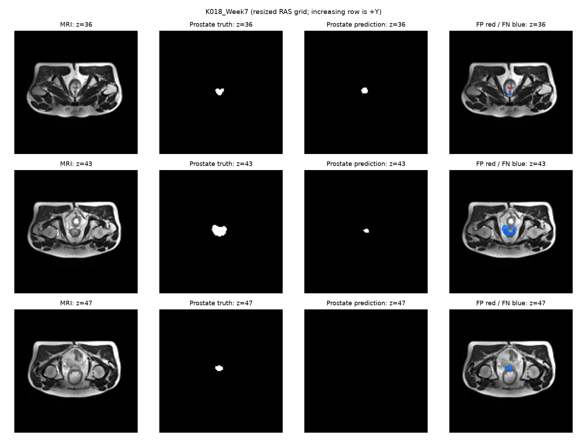
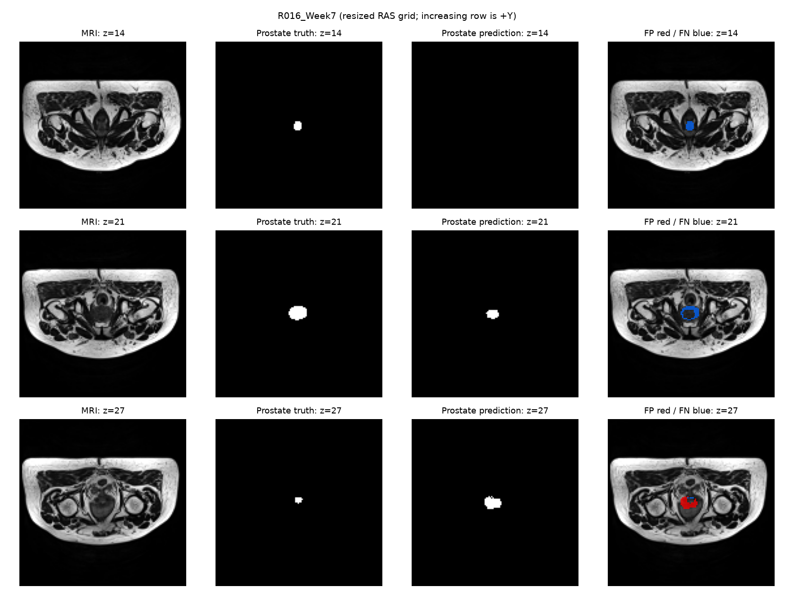
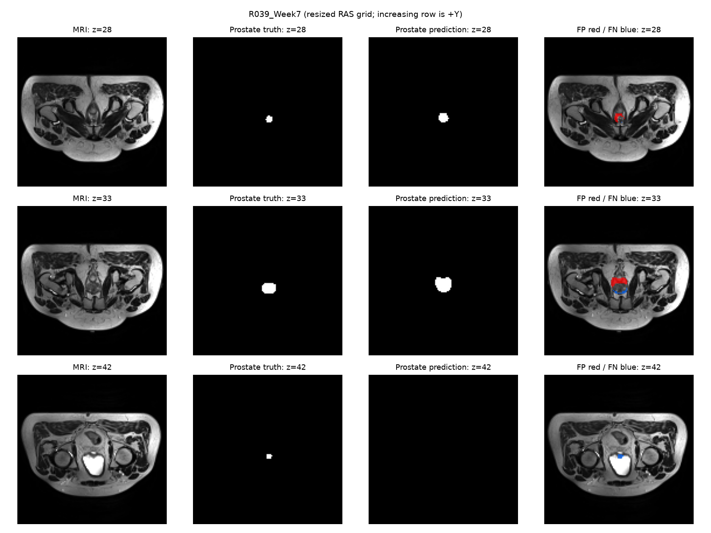

# Verified CAN3D continuation and frozen model selection — 29 October 2026

Run 709852 resumed the unchanged whole-volume Dice+CE recipe from epoch 3 to 8. The first three history entries match the original pilot. All five training-source hashes, the split hash and all 48 validation case identities match; six-class patient averages were independently recomputed. Best weights are epoch 7, confirmed by separate complete validation. No held-out test result is available.

| Epoch | Train objective | Validation prostate Dice | Seconds including validation |
|---:|---:|---:|---:|
| 1 | 1.002114 | 0.245025 | 285.2 |
| 2 | 0.532697 | 0.492840 | 283.1 |
| 3 | 0.394109 | 0.674381 | 288.0 |
| 4 | 0.323312 | 0.620199 | 289.4 |
| 5 | 0.280534 | 0.687902 | 292.2 |
| 6 | 0.268815 | 0.719128 | 288.7 |
| 7 | 0.236143 | 0.719317 | 289.6 |
| 8 | 0.218206 | 0.714964 | 290.8 |

| Class | Patient-macro Dice | Patient-macro IoU |
|---|---:|---:|
| Background | 0.994363 | 0.988826 |
| Body | 0.968608 | 0.939310 |
| Bones | 0.784312 | 0.646494 |
| Bladder | 0.746982 | 0.621273 |
| Rectum | 0.683967 | 0.530558 |
| Prostate | 0.719317 | 0.570924 |

The fixed epoch-7 checkpoint SHA256 is
`76350738141f1765d1f3d1714bf9b51f339e2efe2aff52bb2383cc84d6355991`. Peak training allocation was 909.998 MiB for each epoch; this is not the final inference-memory benchmark.

Three low-scoring validation examples from different patient groups were selected before final testing:

**K018_Week7**: prostate Dice 0.367318. Large missed regions, including the largest labelled slice, show under-segmentation.

**R016_Week7**: prostate Dice 0.532976. The first labelled slice is missed; the largest slice has missed tissue and the last has excess contour.

**R039_Week7**: prostate Dice 0.619409. Excess prediction is prominent on the last labelled slice; central boundaries show mixed errors.

These are observed error patterns, not proven clinical causes. First/last labelled slices are not independently verified anatomical base/apex positions. Small targets, resolution loss and optimization are plausible contributors; the images alone do not isolate one cause.

The C032_Week0 independent preview now exactly matches the full best-validation report for all six Dice/IoU values and predicted voxel counts after aligning its seed/deterministic policy.

CAN3D validation prostate Dice is 0.719317, versus 0.694518 for the selected 2D U-Net. Training recipes and update counts differ, so this is not a controlled architecture-only improvement claim. Neither value is a final test score.

The [frozen final evaluation plan](../final_evaluation_plan.json) fixes both validation-selected epoch-7 checkpoints, the original 27-scan/six-group test split, input grid and profiling settings before seeing test results. No additional tuning will use these results.
